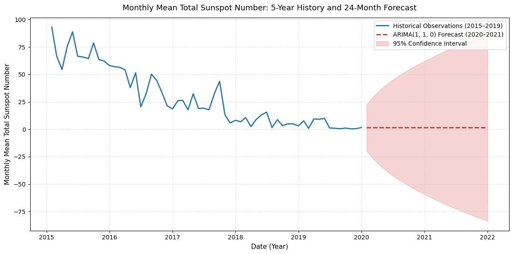

# Forecasting monthly sunspot activity

How accurately can recent observations predict a year of solar activity? I tested an ARIMA forecast against the 12 monthly observations from 2019. Its root mean squared error (RMSE) was **3.88 sunspots**.

## Data and evaluation design

The target was the monthly mean total sunspot number. I selected 60 consecutive observations from January 2015 through December 2019 and checked the date and target columns for missing values and duplicate months. I kept the observations in calendar order so every forecast used only data available before its evaluation period.

| Decision | Training period | Evaluation period | RMSE (sunspots) |
|---|---|---|---:|
| Select model order | Jan 2015–Dec 2017 | Jan–Dec 2018 | 4.34 |
| Test the selected order | Jan 2015–Dec 2018 | Jan–Dec 2019 | 3.88 |

## Choosing the model

I differenced the series once and evaluated 121 combinations of autoregressive and moving-average orders. With only 36 training months, 35 fits converged, 84 failed to converge, and two returned numerical errors.

Among the converged models, ARIMA(1,1,0) had the lowest 2018 validation RMSE at 4.34. The simpler ARIMA(0,1,0) scored 4.43 on the same months. That small margin favored retaining one autoregressive term. I then fixed the order, refit through 2018, and evaluated the forecast on 2019.

## What the longer forecast shows

After the held-out test, I used the five-year history to produce a separate 24-month outlook. The point forecast settled near 1.4 sunspots, while its 95% interval widened from roughly −20 to 22 in January 2020 to −84 to 86 in December 2021. Negative counts are physically impossible. The widening interval illustrates the limits of extending this short-history model two years ahead. The reported 3.88 RMSE applies only to the 2019 test.
